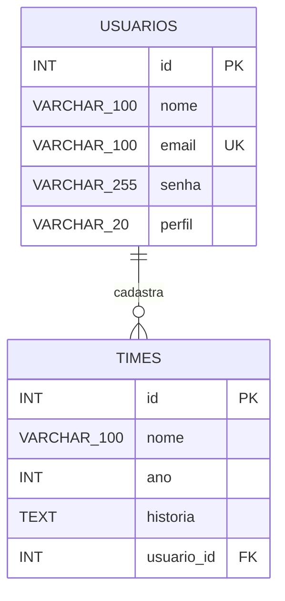

# Liga dos Pereba — Documentação Técnica do Sistema

---

## 1. Introdução

### 1.1 Escopo do Sistema
O **Liga dos Pereba** é uma aplicação web desenvolvida para catalogar, organizar e divulgar a história de grandes esquadrões e times marcantes do futebol mundial. A plataforma permite a consulta pública de acervos, a busca por equipes, o cadastro de novos times por usuários autenticados e a administração/moderação de conteúdo por usuários com perfil elevado.

O sistema possui autenticação de usuários baseada em sessões HTTP e controle de autorização em dois níveis: usuários comuns (com privilégio de publicação) e administradores (com privilégios exclusivos de edição e exclusão de registros).

### 1.2 Propósito
O propósito do projeto é oferecer aos torcedores e entusiastas do futebol uma interface fluida, moderna e responsiva inspirada no padrão visual da **UEFA Champions League** (modo noturno, cores ciano/dourado e tipografia Montserrat). Além disso, serve como artefato prático de desenvolvimento web utilizando PHP estruturado, banco de dados PostgreSQL e CSS3 sem dependência de frameworks externos.

---

## 2. Como Executar o Projeto Localmente

### 1. Clonar o repositório
Clone o repositório dentro da raiz do seu servidor web:

```bash
sudo git clone https://github.com/Timas1150/projeto_integrador.git
cd projeto_integrador
```

### 2. Configurar o banco de dados
Na pasta do projeto, abra o PostgreSQL pelo terminal e informe a senha de `postgres`:

```bash
sudo -u postgres psql
```

Dentro do `psql`, execute os comandos abaixo para criar o usuário com senha `liga_pereba`, criar o banco e importar o dump das tabelas:

```sql
CREATE USER timas WITH PASSWORD 'timas';
CREATE DATABASE liga_pereba OWNER liga_pereba;
\c liga_pereba
\i 'database/liga_pereba.sql'
\q
```

O dump cria as tabelas e concede ao usuário `timas` as permissões para a aplicação. Execute essa instalação em um banco novo.

### 3. Executar a aplicação
No navegador, acesse `http://localhost/projeto_integrador/index.php` (ou execute `php -S localhost:8000` na pasta do projeto).

---

## 3. Descrição Global

### 3.1 Público-alvo
* **Fãs de Futebol e Torcedores:** Pessoas que desejam pesquisar e ler sobre momentos e elencos históricos.
* **Usuários Cadastrados:** Torcedores e colaboradores que desejam registrar a história de seus times favoritos.
* **Administradores:** Gestores responsáveis por moderar o acervo, corrigir informações e excluir registros indevidos.

### 3.2 Perfis de Acesso

| Perfil | Responsabilidade e Acesso |
| :--- | :--- |
| **Visitante** | Acessar a Home (`index.php`), consultar e pesquisar no acervo de times (`app/select.php`), visualizar histórias e acessar as telas de login e cadastro. |
| **Usuário Cadastrado** | Todas as permissões de visitante (`perfil = 'user'`), além de autenticar-se no sistema e cadastrar novos times no acervo (`app/create.php`). |
| **Administrador** | Todas as atribuições do usuário cadastrado (`perfil = 'admin'`), com permissão exclusiva de edição (`app/update.php`) e exclusão de times (`app/delete.php`). |

### 3.3 Principais Telas

| Tela | Finalidade |
| :--- | :--- |
| **Início / Home (`index.php`)** | Página principal com cabeçalho institucional, navegação e apresentação do sistema. |
| **Times (`app/select.php`)** | Listagem geral de todos os times cadastrados no sistema com suporte à busca dinâmica. |
| **Cadastrar Time (`app/create.php`)** | Formulário de inclusão de novos times (exclusivo para usuários autenticados). |
| **Editar Time (`app/update.php`)** | Alteração dos dados cadastrais de um time (exclusivo para Administradores). |
| **Login (`login/login.php`)** | Interface de autenticação de usuários cadastrados. |
| **Cadastro (`login/cadastrar.php`)** | Interface para criação de novas contas de usuário. |

---

## 4. Requisitos do Sistema

### 4.1 Requisitos Funcionais (RF)

| ID | Requisito | Descrição | Prioridade |
| :--- | :--- | :--- | :--- |
| **RF01** | Cadastro de usuários | Permitir a criação de contas com nome, e-mail e senha. | Alta |
| **RF02** | Login | Validar credenciais de acesso e iniciar a sessão do usuário. | Alta |
| **RF03** | Logout | Encerrar com segurança a sessão ativa do usuário. | Alta |
| **RF04** | Cadastro de times | Permitir que usuários autenticados cadastrem novos times (nome, ano e história). | Alta |
| **RF05** | Consultar acervo | Exibir a listagem dos times cadastrados com estilo e formatação organizada. | Alta |
| **RF06** | Pesquisa | Permitir filtrar e localizar times por palavra-chave ou nome na tela de consulta. | Alta |
| **RF07** | Identificação do perfil | Diferenciar e controlar os acessos no sistema com base no campo `perfil`. | Alta |
| **RF08** | Edição de times | Permitir que usuários administradores alterem informações de times existentes. | Alta |
| **RF09** | Exclusão de times | Restringir a remoção de registros do acervo exclusivamente ao perfil administrador. | Alta |

### 4.2 Requisitos Não Funcionais (RNF)

| ID | Requisito | Descrição | Prioridade |
| :--- | :--- | :--- | :--- |
| **RNF01** | Tecnologias | Construir o sistema utilizando PHP, PostgreSQL, HTML5 e CSS3 nativo. | Alta |
| **RNF02** | Identidade visual | Adotar tema escuro inspirado na UEFA Champions League, utilizando variáveis CSS e a fonte Montserrat. | Média |
| **RNF03** | Usabilidade | Prover menus centralizados, botões estilo pílula e navegação fluida em todas as telas. | Alta |
| **RNF04** | Controle de acesso | Validar a sessão HTTP e as permissões de usuário no servidor para operações restritas. | Alta |
| **RNF05** | Integridade dos dados | Manter a consistência e os relacionamentos de chave estrangeira entre usuários e times. | Alta |
| **RNF06** | Compatibilidade | Assegurar a renderização responsiva nos principais navegadores modernos. | Média |

### 4.3 Regras de Negócio (RN)

| ID | Regra de Negócio |
| :--- | :--- |
| **RN01** | O usuário precisa estar obrigatoriamente autenticado para cadastrar um time. |
| **RN02** | Qualquer usuário autenticado (comum ou administrador) pode submeter um novo time. |
| **RN03** | Apenas contas com `perfil = 'admin'` possuem permissão para alterar ou remover times do acervo. |
| **RN04** | As permissões de acesso e exclusão devem ser validadas no lado do servidor, prevenindo burlas por URL direta. |
| **RN05** | O formulário de cadastro de usuários deve atribuir por padrão `perfil = 'user'`. |
| **RN06** | A exclusão de um time é permanente e o registro deixa de aparecer imediatamente nas consultas e buscas. |

---

## 5. Diagramas e Fluxos

### 5.1 Diagrama Entidade-Relacionamento (DER)



---

### 5.2 Mapa de Funcionalidades por Perfil

```text
[ Visitante ]
 ├── Visualizar Home (index.php)
 ├── Consultar e Pesquisar Acervo de Times (app/select.php)
 ├── Acessar Tela de Login (login/login.php)
 └── Acessar Tela de Cadastro de Usuário (login/cadastrar.php)

[ Usuário Cadastrado (perfil = 'user') ]
 ├── (Todas as permissões de Visitante)
 ├── Autenticar no Sistema (Login / Logout)
 └── Cadastrar Novo Time Histórico (app/create.php)

[ Administrador (perfil = 'admin') ]
 ├── (Todas as permissões de Usuário Cadastrado)
 ├── Editar Registros de Times (app/update.php)
 └── Excluir Times do Acervo (app/delete.php)
```

---

## 6. Roteiro de Verificação Manual

| Cenário | Ação Executada | Resultado Esperado |
| :--- | :--- | :--- |
| **01. Login Válido** | Digitar e-mail e senha de uma conta existente. | Acesso concedido, sessão iniciada e exibição da saudação no menu. |
| **02. Login Inválido** | Inserir e-mail não registrado ou senha incorreta. | Recusa do acesso e mensagem de erro exibida. |
| **03. Logout** | Clicar no botão do perfil para encerrar a sessão. | Destruição da sessão e bloqueio de páginas privadas. |
| **04. Cadastro de Time** | Preencher o formulário de cadastro com nome, ano e história. | Time salvo no banco e exibido no acervo geral (`app/select.php`). |
| **05. Pesquisa de Times** | Digitar um termo no campo de busca (ex.: "Bayern"). | Filtro aplicado com sucesso exibindo apenas os resultados correspondentes. |
| **06. Bloqueio de Edição (User)** | Tentar acessar a rota de edição logado como usuário comum. | Acesso bloqueado pelo servidor com negação de permissão. |
| **07. Exclusão de Time (Admin)** | Clicar no botão "Deletar" utilizando uma conta de administrador. | Time removido permanentemente da base de dados e do acervo. |

---

## 7. Prototipagem

O planejamento visual e a estrutura das telas foram desenvolvidos em um protótipo de baixa fidelidade interativo.

* **Link de Acesso ao Protótipo no Excalidraw:**  
  [Acessar Prototipação no Excalidraw](https://excalidraw.com/#room=26d39aa295942ffb0187,iOLix3GvB7HOCSHm4Bb7Dg)
